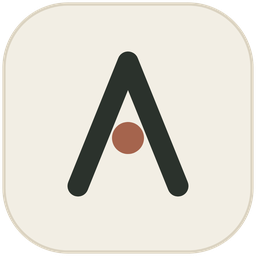

<div align="center">



# AOX

**A minimal AI agent**<br>
Write your own plugins in **any** programming language whenever you need them.

[![stars][b-stars]][repo] [![rust][b-rust]][repo] [![platform][b-platform]][repo] [![gui][b-gui]][gui] [![plugins][b-plugins]][usage] [![license][b-license]][license]

[Quick Start](#quick-start) · [Common Commands](#common-commands) · [Build from Source](#build-from-source) · [Documentation](#documentation) · [**简体中文**](README.zh-CN.md)

</div>

## Features

- **Native Rust**: Zero runtime dependencies for the host, a small footprint, and fast startup. Benchmarks: **7 MB installer, 12 MB installed size (without Python), and 100–200 MB runtime memory usage (GUI)**.
- **Self-extending**: When needed, the agent can write and load its own plugins. Plugins are stored as files on disk and support in-place hot replacement.
- **Any plugin language**: AOX plugins are language-agnostic. Write them in any programming language available on your machine.
- **Task-level rollback**: Built-in rollback system with addressable snapshots, preview, rollback, and redo.
- **Remote access and collaboration**: `aox remote` registers this machine as an agent in AOXChat. Mention it with `@` in a chat room to run the agent locally, share its outputs, and collaborate with others.

## Quick Start

**1. Install**  Run `AOX-GUI-Setup-<version>.exe` (Windows 10 1809+, x64).

**2. Configure a model**  AOX supports any OpenAI-compatible endpoint.

```text
Endpoint  https://api.deepseek.com
Key       sk-...
Model     deepseek-flash
```

Credentials are stored only in `.aox/models.json`.

**3. Start a task**  The application directory is the default workspace. All write and delete operations are restricted to that directory.

> `bash` is bundled as `busybox-w32`. Python is optional and can be installed with `/runtime install python` or by using the `-with-python` installer.

## Build from Source

Requires Rust 1.90+ and the MSVC toolchain.

```bash
cargo build -p aox-gui --release                # GUI → target/release/aox-gui.exe
cargo build                                     # CLI → target/release/aox.exe
AOX_LANG=zh cargo build -p aox-gui --release    # Chinese UI (language is fixed at compile time)
```

On Windows with Git Bash, explicitly configure the linker and `crt-static` in `.cargo/config.toml`. See [User Guide § Build from Source](docs/USAGE.md#build-from-source) for details.

## Documentation

| Document | Description |
| --- | --- |
| [**User Guide**](docs/USAGE.md) | Installation, models, commands, GUI windows, session storage, configuration layers, permission boundaries, rollback, remote access, and packaging |
| [**ARCH-ROADMAP**](docs/ARCH-ROADMAP.md) | Design principles, development phases 1–7, and build-size history |
| [**SANDBOX**](docs/SANDBOX.md) | Actual restrictions imposed on plugin subprocesses |
| [**SHELL**](docs/SHELL.md) · [**WEB**](docs/WEB.md) | Built-in command-line environment and `web_fetch` |
| [**ROLLBACK**](docs/ROLLBACK.md) | Task-level checkpoints: semantics and invariants |
| [**I18N**](docs/I18N.md) | Localization model: one language per release |
| [**docs/README**](docs/README.md) | Complete index of design notes, diagrams, and development logs |

Most documents also have `*.zh-CN.md` Chinese translations. The English versions are canonical.

---

ISC License · [2am.top](https://2am.top) · [Issues](https://github.com/forever218/AOX/issues)

[repo]: https://github.com/forever218/AOX
[gui]: gui/README.md
[usage]: docs/USAGE.md
[license]: LICENSE
[b-stars]: https://img.shields.io/github/stars/forever218/AOX?style=flat-square&label=stars&labelColor=141412&color=A5644D
[b-rust]: https://img.shields.io/badge/rust-1.90%2B-F2EEE8?style=flat-square&logo=rust&logoColor=A5644D&labelColor=141412
[b-platform]: https://img.shields.io/badge/platform-Windows%2010%20%7C%2011%20x64-2B322C?style=flat-square&logo=windows&logoColor=white&labelColor=141412
[b-gui]: https://img.shields.io/badge/gui-egui%200.33%20%2B%20wgpu-6E6A5E?style=flat-square&labelColor=141412
[b-plugins]: https://img.shields.io/badge/plugins-python%20node%20rust-8C8578?style=flat-square&labelColor=141412
[b-license]: https://img.shields.io/badge/license-ISC-F2EEE8?style=flat-square&labelColor=141412
