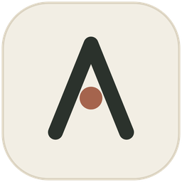

<div align="center">



# AOX

**一个自我增长的 AI 编程代理。**<br>
没有任何工具——缺什么，就自己写一个。

[![stars][b-stars]][repo] [![rust][b-rust]][repo] [![platform][b-platform]][repo] [![gui][b-gui]][gui] [![plugins][b-plugins]][usage] [![license][b-license]][license]

[快速开始](#快速开始) · [常用命令](#常用命令) · [从源码构建](#从源码构建) · [文档](#文档) · [**English**](README.md)

</div>

- **零工具起步。** 宿主只有一个核心循环和三个元工具，没有文件、shell、网页工具。
- **缺什么自己造。** 要读文件？它写一个插件、注入、下一轮直接调用。
- **会记住。** 插件就是磁盘上的文件，重启自动恢复——越用越强。
- **一套内核，两个外壳。** CLI 与 GUI 是同一个 agent 上的两个 `Ui` 实现。

## 快速开始

**① 运行。** 双击 `aox-gui.exe`（命令行版是 `aox.exe`）。首次启动会自动弹出「添加模型」。
`config.toml` 里**没有** `[provider]` 段——模型存在 `.aox/models.json`，两个版本读的都是它。

**② 添加模型。** 任何 OpenAI 兼容端点都行，点「扫描」可以自动填模型名。

```text
端点    https://api.deepseek.com
Key     sk-...
模型    deepseek-flash
```

**③ 直接说人话。** 比如「读取 config.toml，告诉我里面有哪些配置项」——它发现自己没有文件读取
能力，会先造一个 `fs` 插件，然后用它完成任务。这个插件留在磁盘上，重启后依然在。

> **不需要任何运行时。** 宿主静态链接，不依赖 VC++ 运行库，也不需要 Python / Node。
> 只有 python / node **插件**才要解释器；rust 插件编译成原生 exe。

## 常用命令

| 命令 | 作用 |
| --- | --- |
| `/help` | 全部命令（含下面这些） |
| `/tools` · `/plugins` | 现在能做什么，以及加载了哪些插件 |
| `/model` | 列出已保存的模型；`/model 2` 切换，下一个请求生效 |
| `/history` | 历史对话——`show 1` · `open 1` · `rm 1` · `dir` |
| `/new` | 开一段新对话（当前这段已经落盘） |
| `/runtime` | 解释器状态；`/runtime install python` 自动装配 |
| `/expand` | 展开上一次被折叠的工具调用 |
| `/quit` | 退出；`Ctrl+C` 中断正在跑的任务 |

## 从源码构建

```bash
cargo build -p aox-gui --release   # GUI → target/release/aox-gui.exe
cargo build                        # CLI → target/release/aox.exe
```

需要 Rust 1.90+ 与 MSVC 工具链。Windows + Git Bash 下要在 `.cargo/config.toml` 里显式指定
链接器与 `crt-static`——见 [使用手册 § 从源码构建](docs/USAGE.zh-CN.md#从源码构建)。

## 文档

| 文档 | 内容 |
| --- | --- |
| [**使用手册**](docs/USAGE.zh-CN.md) | GUI 布局、历史文件格式、运行时解析、发行产物、故障排查 |
| [**ARCH-ROADMAP**](docs/ARCH-ROADMAP.zh-CN.md) | 七条设计原则、阶段 1–7、每次构建的体积全史 |
| [**SANDBOX**](docs/SANDBOX.zh-CN.md) | 插件子进程现在实际被挡住了什么 |
| [**SHELL**](docs/SHELL.md) · [**WEB**](docs/WEB.zh-CN.md) | shell 工具与 `web_fetch` |
| [**I18N**](docs/I18N.zh-CN.md) | 一种语言一个发行版 |
| [**docs/README**](docs/README.zh-CN.md) | 完整索引——设计记录、图表、工作笔记 |

多数文档旁边都有一份 `*.zh-CN.md` 副本，英文是源语言。

---

ISC License · [2am.top](https://2am.top) · [Issues](https://github.com/forever218/AOX/issues)

[repo]: https://github.com/forever218/AOX
[gui]: gui/README.zh-CN.md
[usage]: docs/USAGE.zh-CN.md
[license]: LICENSE
[b-stars]: https://img.shields.io/github/stars/forever218/AOX?style=flat-square&label=stars&labelColor=141412&color=A5644D
[b-rust]: https://img.shields.io/badge/rust-1.90%2B-F2EEE8?style=flat-square&logo=rust&logoColor=A5644D&labelColor=141412
[b-platform]: https://img.shields.io/badge/platform-Windows%2010%20%7C%2011-2B322C?style=flat-square&logo=windows&logoColor=white&labelColor=141412
[b-gui]: https://img.shields.io/badge/gui-egui%200.33%20%2B%20wgpu-6E6A5E?style=flat-square&labelColor=141412
[b-plugins]: https://img.shields.io/badge/plugins-python%20node%20rust-8C8578?style=flat-square&labelColor=141412
[b-license]: https://img.shields.io/badge/license-ISC-F2EEE8?style=flat-square&labelColor=141412
